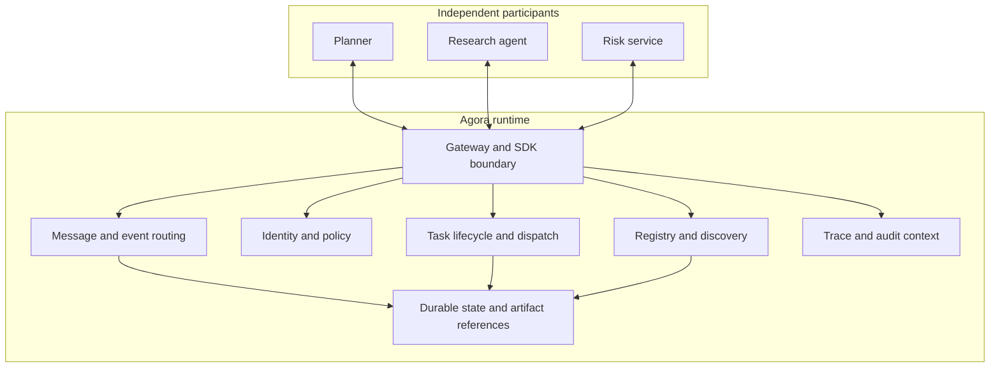

# Architecture overview

**Status: Proposed logical architecture.** Components describe responsibilities, not a required deployment topology. Early implementation may keep several responsibilities in one service.

## System boundary

Agora sits between agent applications and their communication dependencies. Agent applications own execution, model choice, prompts, memory, and domain logic. Agora owns shared network services such as registration, discovery, routing, task state, communication history, policy enforcement, and trace linkage.

## Logical view

## Logical responsibilities

| Responsibility | Purpose | Key questions |
|---|---|---|
| Gateway and SDK boundary | Accept authenticated client operations; normalize contracts | HTTP, streaming, local transport, version negotiation |
| Registry and discovery | Store registrations, capabilities, and endpoint/presence data | Registration ownership, expiry, search and trust model |
| Identity and policy | Authenticate participants and authorize actions | Identity provider, policy language, tenant boundary |
| Message and event routing | Deliver direct messages and channel events | Persistence, ordering, acknowledgement, subscription behavior |
| Task lifecycle and dispatch | Create, claim, execute, cancel, and finish durable work | Worker model, lease semantics, retry ownership |
| Durable state | Preserve registered entities and lifecycle history | Database, retention, archival, recovery |
| Artifact references | Connect messages/tasks to large or durable outputs | Storage backend, access control, expiry |
| Trace and audit context | Link communication and policy outcomes | OpenTelemetry mapping, sensitive-field handling |

## Control and data responsibilities

The registry, identity, capability discovery, and policy functions form a logical control plane. Message delivery, event fan-out, and task dispatch form a logical data plane. This distinction helps explain behavior; it does not require separate services.

## Target interaction paths

### Direct request

Caller authenticates, resolves recipient or capability, passes authorization, sends request, and receives result or task handle. Runtime records causal links across caller and recipient.

### Asynchronous task

Caller creates task with deadline and context. Runtime persists task before reporting accepted state, dispatches work, tracks claim/lease and state changes, then makes result or failure inspectable. Whether acceptance implies durable commit is an explicit contract choice.

### Event publication

Publisher submits event to channel. Runtime authorizes publication, records event identity, routes it to eligible subscribers, and exposes delivery outcomes according to chosen subscription semantics.

## Initial implementation shape

The source brief names Python/FastAPI, Redis or Redis Streams, PostgreSQL, Python and TypeScript SDKs, OpenTelemetry, and a Next.js console as possible stack. These are candidates only. No technology choice is accepted yet.

Redis plus PostgreSQL is one possible early split between transient coordination and durable state. Before choosing, compare simpler single-store options and required recovery/ordering guarantees. Keep public contracts independent of transport backend where feasible.

## Scaling boundary

Start with one deployable runtime and clear internal boundaries. Split services only when workload, failure isolation, or independent scaling provides measurable benefit. Avoid distributed architecture merely because participants are distributed.

## Architecture decisions

See [ADR-0001](decisions/0001-runtime-scope.md) for accepted product scope and [open design questions](open-questions.md) for choices still pending.
